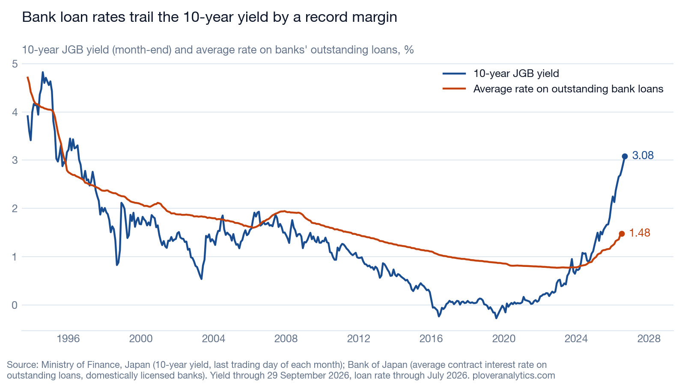

# Japan's bond market has repriced and its bank loans have not: about ¥10 trillion a year sits in the gap

The 10-year Japanese government bond yield closed at 3.082% on 29 September 2026, the highest since August 1996, while the average rate on banks' outstanding loans was 1.483% in July, the latest month published. The cost of money has reset in the bond market and has not yet reached most borrowers. Applied to the ¥758.3 trillion of bank loans outstanding, the July gap of 1.318 percentage points is equivalent to roughly ¥10.0 trillion of interest a year.

The gap is the widest since the loan series begins in October 1993, and the yield has exceeded the loan-book rate for 28 consecutive month-ends; it did so in only 62 of the 394 months on record. Four implications follow.

**Borrowers face a further rise in interest costs.** The loan-book rate rose 0.346 percentage points in the twelve months to July, against 1.242 points for the month-end 10-year yield. Each 0.1 point added to the loan book costs borrowers about ¥0.76 trillion a year. The ¥10.0 trillion figure is the scale of the full adjustment, not a forecast of its timing; it compares with banking-sector net income of ¥6.03 trillion in the year to March 2026.

**Bank earnings depend on deposit rates lagging.** Deposits of ¥1,084.7 trillion exceed loans, so banks gain from higher rates only while deposit rates rise by less than about 70% of the rise in loan rates. Over the same twelve months the ordinary deposit rate rose 0.072 points, from 0.183% to 0.255%, about one-fifth of the loan-book increase. That margin is the source of the earnings gain, and a 10-year bond yielding 3.082% against a 10-year time deposit paying 0.927% indicates the pressure on it.

**New lending is priced below the risk-free rate.** Banks wrote new loans at an average of 1.706% in July, 1.095 points below the 10-year yield at that month-end. Either new-loan pricing rises, or the government bond becomes the more attractive asset for the marginal yen.

**Bond valuation losses will have grown.** The 10-year yield has risen 0.716 points since banks closed their books on 31 March 2026 at 2.366%. Bonds held at that date are worth less at the September half-year.

The loan-book average covers all maturities, including short-term and floating-rate loans, so part of the gap reflects term rather than lag. Loan and deposit balances are at March 2026; rates are at July and September.

*Sources: Ministry of Finance, Japan (10-year constant-maturity yield, daily close). Bank of Japan, Time-Series Data Search (average contract interest rates on loans; average interest rates posted on deposits). Japanese Bankers Association, Analysis of Financial Statements of All Banks (loans, deposits and net income, all banks). Rates and balances as published; yen equivalents and differences are calculated from them.*

**Charts and data**

- 10-year yield: [ploveranalytics.com/rates.html](https://ploveranalytics.com/rates.html) · [data as of 30 September 2026 (CSV)](https://ploveranalytics.com/api/v1/jgb-yields/observations?series=10Y&start=1974-09&format=csv&as_of=2026-09-30)
- Bank loan rates: [data as of 30 September 2026 (CSV)](https://ploveranalytics.com/api/v1/boj-loan-rates/observations?series=DLLR2CIDBST1,DLLR2CIDBNL1&start=1993-10&format=csv&as_of=2026-09-30)
- Deposit rates: [data as of 30 September 2026 (CSV)](https://ploveranalytics.com/api/v1/boj-deposit-rates/observations?series=DLDR43TL610YN,DLDR121N&start=2022-04&format=csv&as_of=2026-09-30)
- Bank loans, deposits and net income: [data as of 30 September 2026 (CSV)](https://ploveranalytics.com/api/v1/jba-banks/observations?series=s.all.a015,s.all.d395,s.all.f850.fy&start=2024-03&format=csv&as_of=2026-09-30)
