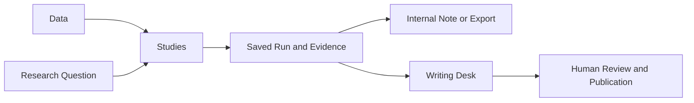

# Plover Studies Workspace Plan

Status: Proposed. Prepared 11 October 2026. Revised 12 October 2026: correlation, lead–lag and regression work on any series Plover holds, in any market, not on one futures pair. Scope: product design and implementation sequence.

*Progress, 15 October 2026:* a first Studies section is built in the Investment Assistant:
plain-English questions, hand-edited queries, every run kept, CSV with provenance. It covers
published series only, not company figures, saved futures or vendor prices (see
[PLAN-AI-DATA-WORKSPACE.md](PLAN-AI-DATA-WORKSPACE.md)).

*Progress, 23 October 2026:* the article editor has a Studies tab beside Research. It lists
the writer's own studies and inserts a study's latest run into the draft as a chart whose
numbers live in the article, with its sources and, for calculated columns, its formula.
Inserting from inside Studies (a button on the study page) is not built.

## Product Direction

Add a dedicated Studies workspace inside Plover. A researcher starts with a question, chooses data and a method, examines the evidence, and saves the investigation. A saved result can support a client note, economic report, internal investment memo or academic paper. An article is optional.

The workspace should serve sell-side equity analysts, economists and strategists first. The same study tools should also work for buy-side researchers, policy researchers and academics. Templates guide the analysis; users can change their inputs and assumptions.

Use the existing Plover account and data permissions. Place Studies within the Research navigation. Keep the existing Data area for finding and inspecting source series, and the writing desk for preparing articles. This proposal does not introduce a separate login or a new top-level navigation item.

## Users and Questions

| User | Main questions | Typical output |
| --- | --- | --- |
| Equity analyst | Margins, valuation, earnings reactions, liquidity | Company or sector note |
| Economist | Inflation, growth, policy transmission, revisions | Economic report |
| Market strategist | Market relationships, leadership, regimes | Strategy note |
| Buy-side researcher | Exposure, risk, robustness, implementation | Internal investment memo |
| Policy researcher or academic | Replication, controls, measurement, uncertainty | Research paper or evidence brief |

Role selection should suggest relevant examples, without changing access rights or hiding other methods. A user can work across disciplines. Begin with guided examples that span the data: a market pair (Brent versus Nasdaq futures), a macro pair (Japan wages versus inflation), a cross-market pair (US versus Japanese 10-year yields), inflation components, and company peer comparisons. Offer a plain New Study action for experienced users.

## Study Types

### Time Series Comparison

Compare economic series, financial measures or market returns over time. Support rebasing, growth rates, differences, ratios, rolling averages and frequency conversion where the source definitions allow them.

Examples include wages versus inflation, exports versus industrial production, company sales versus sector demand, and stock returns versus a benchmark. A monthly flow can be summed into a quarter; a stock may require an end-period value. The researcher must see the aggregation rule rather than receive an automatic, unexplained conversion.

### Relationships and Lead Lag

Measure the relationship between variables at the same time and at different delays. Show correlations, scatterplots, stability over time and sensitivity to session or sample choices. Fit a regression of one series on one or more others, with its diagnostics.

The method is general. Any series Plover can serve to the user is a valid input: official statistics from every registered dataset and market, yields, trade, labour and banking series, saved futures, the user's licensed vendor prices, and company figures. Inputs may come from different markets, frequencies and time zones; the alignment rules below make each join explicit.

Examples include Brent versus Nasdaq futures, US versus Japanese 10-year yields, Japan wages versus inflation, Hong Kong retail sales versus Japan visitor arrivals, bank loan rates versus deposit rates, credit growth versus activity, and input costs versus margins. A result describes an association. A separate validation step tests whether a chosen relationship predicts later observations.

### Events and Reactions

Study what happens around earnings, central-bank decisions, economic releases, guidance changes or corporate actions. Show the reaction before and after the event, its distribution, and performance relative to a stated benchmark.

The event record must distinguish an expected date from the actual announcement timestamp. An earnings calendar alone is insufficient for an intraday reaction study. A macro release surprise requires a timestamped forecast made before the release; actual changes are not surprises.

### Company and Sector Comparisons

Compare peers using consistent definitions for growth, margins, returns on capital, leverage, valuation and liquidity. Show distributions and peer groups alongside rankings. Keep reported figures distinct from calculated ratios.

Save membership and weighting rules. Historical studies need the historical universe, including companies that later delisted, rather than today's surviving constituents. Market-cap screens and valuation ratios remain unavailable until their required price and share-count inputs are verified.

### Economic and Financial Drivers

Explain a change using documented contributions or a specified statistical model. Examples include contributions to inflation, decomposition of company profit growth, and the association between demand, exchange rates and export growth.

An accounting decomposition can reconcile to a published total. A statistical coefficient represents an estimated association under its assumptions. The interface must distinguish these methods and disclose any residual that prevents exact reconciliation.

### Forecasts and Scenarios

A later extension should support simple forecasts, benchmark comparisons and user-defined scenarios. Separate observed data, estimated forecasts and assumed inputs. Save the training cutoff and evaluate forecasts on later observations. Scenario results must retain the assumed path that generated them.

This extension depends on validated earlier methods. Portfolio optimisation, trade execution and an unrestricted notebook environment are outside the initial release.

## Navigation and Workflow

The workspace answers: “What does the evidence say about my research question, and can I reproduce it?”

### Study Library

Open Studies to see a searchable list of investigations. Each row shows the title, method, scope, latest run date and status. Personal studies are the default. Publication studies appear only where the user has access.

Actions are New Study, Open, Duplicate and Archive. Archive is recoverable. Filters include method, dataset, market and status. Use lists and tables rather than a grid of feature cards. A blank library should explain how to start and offer the guided examples.

### Study Workspace

Use four visible stages: Question, Data and Method, Results, and Notes and History. Keep the main chart wide, with supporting tables and evidence below it. Use a compact setup panel on desktop and a single-column flow on mobile.

The setup collects the question, study type, variables or universe, dates, frequency, transformations, controls and benchmark. Show a Data Check before Run: coverage, missing observations, source versions, units, timing and permissions. Advanced controls expand only when needed; defaults remain visible and editable.

Run is the primary action while setting up. After a run, Insert into Draft is primary when a writer is ready to use its evidence. Re-running after an input change creates a new run and preserves the previous result.

### Results and Evidence

Results begin with a factual summary of the calculation and its limitations. Follow with the main chart, supporting views, a numerical table, and Show Calculation. Each displayed result links to the inputs, method and source release.

Let users mark a result as a Finding, Open Question or Discarded Hypothesis. These are analyst notes, not automated verdicts. Contradictory results remain in the run history.

### Outputs

Save runs independently of articles. Support PNG with source information, plotted-data CSV with metadata, an authenticated link to the saved result, and insertion into an existing or new draft. CSV export retains numerical precision even when the display rounds it.

An inserted chart is pinned to a run. Later data or assumptions create a new run; they do not silently change the article's evidence. The writer can explicitly replace the chart. Research calculations never publish an article automatically.

## Relationship Engine

One engine serves every relationship study. It takes two or more series from any source the user may read, aligns them, applies the chosen transformations, and returns correlations at each delay, a rolling correlation, a scatterplot and, where requested, a regression. Instrument-specific rules (contract rolls, exchange sessions) plug in as data rules for that source; they are not separate tools.

- **Frequency.** Series at different frequencies are joined at the lower one. The user sees and can change the conversion: a flow is summed, a stock takes the end-period value, a rate takes the period average. Nothing is converted silently.
- **Delay unit.** A delay is measured in the joined frequency: hours for intraday data, days, months or quarters otherwise. The scan range defaults to that frequency and is editable.
- **Timing.** Each observation carries the period it describes and, where known, when it became available. Predictive tests use availability; descriptive tests may use the period. Cross-market joins state the common cutoff, for example the Tokyo close against the previous New York close.
- **Units and measure types.** Units travel with each series. Levels, changes, stocks and flows are labelled, and the template proposes a transformation (returns, differences or growth rates) before a run on trending levels.
- **Regression.** Ordinary least squares on one or more explanatory series and their delays. Report coefficients with dependence-aware uncertainty, R², observations used, and residual checks for autocorrelation and stability. A coefficient is labelled an estimated association, never an effect.
- **Pairs and sets.** A user may test one pair, one series against a chosen list, or a small matrix. Every pair tried is recorded with the run, and results across many pairs show how many were tested, so a chance hit is not presented as a finding.

## Worked Example Futures Lead Lag

This is one of the launch examples, not the boundary of the tool. Its hourly, contract-roll and session rules apply to intraday futures data only.

Start with Nasdaq-100 futures versus ICE Brent exchange trades and CME Nikkei yen futures versus the same Brent feed. Label the futures instruments explicitly; they are proxies for the NDX and NKY cash indices. Keep off-market Brent trades as a separately labelled choice.

Use the common coverage of the selected data releases. Begin with hourly observations and a configurable scan from 24 hours before to 24 hours after. Later add a daily view with a stated common cutoff, rather than silently comparing exchanges' different closing times.

Calculate within-contract log returns as `100 × ln(close_t / close_previous_hour)`. Require valid adjacent hour endpoints and the same contract. Omit returns spanning a contract switch or a missing hour. Databento continuous symbols map to actual contracts and return unadjusted prices, so roll jumps must be handled explicitly. [Databento symbology](https://databento.com/docs/standards-and-conventions/symbology)

Treat an hourly bar's close as available only after its interval ends. Align by interval endpoints in UTC, with session labels based on the appropriate exchange calendar and daylight-saving rules. A three-hour lag means three elapsed hours, not three available rows. Never fill market closures with artificial observations.

For a positive delay `h`, calculate `corr(Brent return at t, equity return at t+h)`. Label this side Brent Moves First. Negative delays indicate Equities Move First. Zero is Same Hour. Display both the sign and magnitude of the correlation; the largest absolute value may be negative.

Provide a lag curve, a rolling correlation at a selected lag, a scatterplot, and a table containing correlation, matched observations and uncertainty for each delay. Show how many observations the timing and roll checks excluded. Offer US, Japan and full-session comparisons without searching hidden combinations for a preferred result.

Separate Explore from Validate. Explore identifies candidate lags on an earlier sample. Validate locks the selected lag and tests it on a later untouched sample. Show simultaneous uncertainty for the lag scan using a documented procedure that preserves time dependence. Record every tried configuration. A statistically notable relationship is not, by itself, evidence of causation or net trading profits.

The common saved history includes the period beginning with Brent's 2018 coverage. Use the exact selected releases to determine the endpoints at run time. The current futures imports require manual updates, so show their last saved observation prominently.

## Second Study Japan Mid Cap Liquidity and Earnings

Frame the hypothesis as: “Are less-liquid mid-cap stocks associated with larger earnings gaps or slower price adjustment, after accounting for earnings news and other differences?” Keep “illiquidity traps alpha” as a hypothesis to test.

Define mid-cap membership using a historical market-cap range or index definition chosen by the researcher. Measure liquidity before the announcement using turnover, traded value and zero-trading days. Where verified quotes exist, add bid–ask spreads. Where price and volume data exist, add a clearly defined price-impact proxy. These measures describe different aspects of liquidity and should not become an unexplained composite score.

Measure the overnight gap separately from subsequent drift. The gap compares the last traded close before an after-hours announcement with the next valid opening price; announcements during trading require a different event window. Handle holidays, suspensions and corporate actions. Compare low- and high-liquidity groups and report benchmark-adjusted returns, gap dispersion and tail events.

Controls should include size, sector, prior volatility, previous returns and the magnitude of earnings or guidance news where those inputs exist. “Abnormal return” requires a stated benchmark. “Alpha” requires a stated risk model. A market reaction alone does not identify unrecognised fundamental value.

Required inputs are historical membership and market cap, corporate-action-aware open and close prices, volumes, a benchmark, actual announcement times and comparable earnings news. Quotes and pre-announcement consensus forecasts are additional requirements for spread and surprise tests. The existing filings and earnings-calendar infrastructure are reuse candidates; they do not establish complete coverage of these inputs.

Enable only the measures whose data checks pass. A daily price-and-volume study can begin before an intraday or quoted-spread study, but it must describe that narrower scope.

## Economist Workflow

An economist can start with an inflation, growth, labour or trade question using the same workspace. Select series, choose their transformations, and state the timing basis. Separate the period a value describes from when it became available.

Offer three timing choices: latest revised data for descriptive analysis, a named historical vintage for replication, and data available as of each date for predictive tests. Disable an unavailable choice. When historical release coverage is incomplete, identify the available period and avoid claiming a fully historical test.

For example, a user can compare wages and consumption, examine which inflation components changed, or test whether orders preceded production. Monthly and quarterly joins require explicit aggregation. Policy and release studies require actual event dates; forecast-surprise studies require historical consensus observations.

Historical information and today's revised series can answer different questions. FRED's real-time periods distinguish the information available at a specified historical date. The same distinction should be visible in Plover's study setup. [FRED real-time periods](https://fred.stlouisfed.org/docs/api/fred/realtime_period.html)

## Data and Calculation Rules

Every run saves the source IDs, release versions and hashes, requested sample, timing basis, units, transformations, alignment rules, method version and sample exclusions. Store the permission-scoped input snapshot or durable archived references needed to reproduce it.

Use registered Plover datasets and the saved futures service first. A later private upload path can accept the researcher's own CSV with a data dictionary and explicit timing fields. A source preview must identify whether data are official statistics, company disclosures, licensed market data or user supplied.

Show formulas for calculated values. Preserve the project trust contract: official statistics retain their existing labels; derived values expose their calculation rather than receive a new badge. Missing values remain missing throughout joins, charts and exports.

Price levels, trends and seasonality can create misleading associations. Relationship templates should make appropriate returns, differences or growth rates visible and explain their choice. Time-series regression diagnostics must examine residual dependence and stability. [Forecasting Principles and Practice on regression evaluation](https://otexts.robjhyndman.com/fpp3/regression-evaluation.html)

Predictive tests must split observations by time. Parameters and transformations are fitted using the training sample, then held fixed for the later test. Save all model and lag choices. Testing later observations reduces the risk of mistaking a fitted relationship for useful prediction. [Forecast evaluation](https://otexts.robjhyndman.com/fpp3/accuracy.html)

Declare the sampling unit for uncertainty estimates. Hourly bars and repeated company events are not necessarily independent observations. Choose dependence-aware uncertainty appropriate to the method, and disclose clustering, resampling rules and sensitivity checks. Avoid a single universal confidence threshold across every template.

## Ownership and Access

Each study belongs to a personal account or an explicitly selected publication workspace. Research-only users should not need article publication privileges. Team ownership uses existing membership rules where available; method selection never grants access to data.

Private data remain private in inputs, results, exports, caches, links and inserted draft blocks. Validate underlying source permissions at every retrieval and output action. A teammate's ability to read an article does not automatically grant access to its private research inputs. Public output requires a permitted publication path under the source licence; this plan does not assume that derived charts can always be redistributed.

Keep account-owned connections and keys with their owner. Publication sources apply only within that workspace. Do not copy credentials into study records or URLs. A shared administrative login is not a personal researcher identity.

If source access is revoked, retain the run record but block protected payloads and explain how to restore access. Authenticated permalinks reproduce the view for authorised readers; they do not make a study public.

## Research Assistance

Research assistance can help turn a question into a proposed study, explain controls, identify missing data and draft a summary from saved results. The researcher reviews the proposed inputs and method before running it.

All numerical work goes through the tested study calculation tools. The assistant receives permission-scoped results and source references, rather than computing full histories in conversation. Record the tool calls and preserve the analyst's edits. Keep provider choice and paid-data access subject to the user's existing account settings.

## Implementation Structure

Reuse the existing application, authentication, dataset catalog, source history and article block conventions. Keep study metadata and run artifacts in a separate namespace. The dataset core schema remains unchanged.

Suggested implementation boundaries are a study store, a permission-aware data resolver, a bounded run service, versioned calculation methods, study endpoints, and the Studies frontend. These are proposed modules, not existing shipped capabilities.

The store holds study specifications, immutable completed runs, source references and notes. Run artifacts live on the persistent production volume with backup and recovery coverage. Store large inputs and outputs as permission-scoped artifacts, not oversized article blocks. Pending, running, complete, failed and cancelled states survive application restarts.

The resolver uses the same authorised dataset functions as the product API. It returns complete, validated samples to the calculation service, with row and time limits. The assistant cannot bypass permissions or read arbitrary database tables.

A bounded job runner handles larger studies outside the request that submits them. Reuse a suitable existing runner only after checking its restart, cancellation and ownership behaviour. Use an idempotent run submission to prevent double-clicks from creating duplicate work. A failed run leaves earlier completed runs intact.

Expose create, read, update, archive, submit-run, run-status, result and export operations. Authorise each operation server-side. Reuse native chart conventions and the existing article insertion path, with a run identifier and provenance attached to each derived block. Existing code for saved charts is a reuse candidate whose deployed state must be checked before implementation.

Keep compatibility with Python 3.9 and the installed runtime stack. Use vanilla JavaScript and vendored chart components. Validate any numerical method against an independent reference before exposing it; a copied algorithm is not sufficient validation.

## Delivery Sequence

### Phase One Study Foundation and Relationships

Build the library, personal ownership, data checks, saved specifications, immutable runs, basic time-series comparison and the general relationship engine: correlation, lead–lag and regression on any series the user may read. Include article insertion and exports from the first usable release. Macro series from every registered dataset, saved futures, licensed vendor prices and company figures go through the same data interface, with valid transformations and explicit joins.

Exit condition: a researcher can run a relationship study on each of four kinds of pair (two intraday futures; two monthly macro series from one market; two series from different markets; a daily market series against a monthly macro series), fit a regression with at least two explanatory series, reopen identical results, inspect the source and calculation, and insert evidence into a draft. A research-only account can complete the workflow without receiving publication rights. No private data appear through another account or a public link.

### Phase Two Events and Company Comparisons

Add peer universes, event records and benchmark comparisons. Start the Japan mid-cap study only after verifying price, volume, membership and announcement coverage. Add pre-event liquidity groups and separate gap and drift outputs. Enable spreads and surprises when their required inputs exist.

Exit condition: sampled event times and corporate-action handling reconcile to their sources; historical membership is reproducible; selected company events can be checked individually; results disclose missing inputs and exclusions.

### Phase Three Economist Methods and Scenarios

Extend transformations, historical-vintage selection, documented decomposition, forecast evaluation and scenarios. Build on the existing signal-backtest work where its methods and stored sources are suitable; do not inherit an older result as evidence for a new study.

Exit condition: an economist can reproduce a historical-vintage analysis and a held-out forecast evaluation, distinguish assumptions from observations, and export the full method and source record.

Team review, comparison of runs and optional scheduled refreshes can follow demonstrated demand. A scheduled refresh creates a new run and never rewrites earlier evidence. Scheduling and notifications are separate user choices.

## Release Checks

Verify calculations with known synthetic examples and independently computed real samples. For lead–lag, include a known delayed series, reversed direction, negative association, gaps, contract changes and daylight-saving transitions. For joins across sources, include mixed frequencies (daily against monthly, monthly against quarterly), different markets' closing times and holidays, and different units. Check regression coefficients and their uncertainty against an independent statistics package on the same inputs. For events, include after-hours and intraday announcements, suspensions, corporate actions and overlapping events. For macro studies, include revisions, incompatible units, frequency conversion and missing historical vintages.

Test save and reopen, duplicate runs, retries, cancellation, restart recovery, backup restoration and access revocation. Test ownership and data permissions for each endpoint, export and inserted chart. Reconcile exported values with plotted values and pin both to the same completed run.

Use the interface with ordinary searches, long names, missing values and insufficient samples. Show actionable empty and failure states. Check light and dark mode and widths of 390, 768, 1280 and 1440 pixels, including open controls. Use keyboard navigation and readable table alternatives for charts. Keep source information in image exports.

Measure whether users can complete a study, find its source, reopen it and reuse its evidence without help. Track completion and failure rates and time to the first saved result. Set performance budgets after measuring the actual saved histories; do not promise an unmeasured run time or statistical finding.

## Implementation Decisions

Use these defaults when implementation begins: Studies inside Research, private personal ownership, optional publication ownership, guided templates with editable settings, full run history, and manual run submission.

Resolve numerical uncertainty methods and resource limits through a small calculation benchmark. Confirm the account capability needed for research-only users. Verify backup retention and licence rules for each output path. Obtain the missing equity and event data before enabling the liquidity study. These decisions govern implementation; none require changing the proposed core workflow.

## Repository References

- [Project rules](../../AGENTS.md): account ownership, data provenance, dataset boundaries and release checks.
- [Saved futures service](../../observatory/app/market_history.py): instruments, contract identities, private access and immutable releases.
- [Research endpoints](../../observatory/app/research_api.py): current data search, chart and export interfaces.
- [Accounts](../../observatory/app/accounts.py) and [writer access](../../observatory/app/writers.py): identity and publication capabilities.
- [Research publishing plan](PLAN-RESEARCH-PUBLISHING.md): relationship between saved evidence and publishing; historical planning claims need current verification.
- [Signal backtest plan](PLAN-SIGNAL-BACKTEST.md): earlier work on timing and held-out evaluation; market-scope notes are superseded by current project rules.
- [UI design procedure](../../.claude/skills/ui-ux-design/SKILL.md) and [reference](../../.claude/skills/ui-ux-design/reference.md): layout, controls, source information, accessibility and responsive checks. The current project trust contract takes precedence over older badge guidance.
